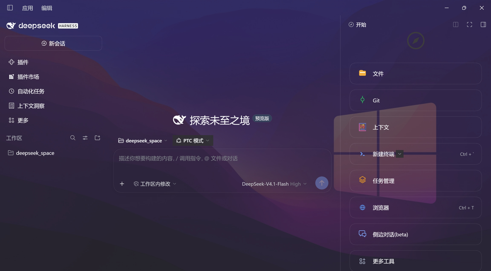
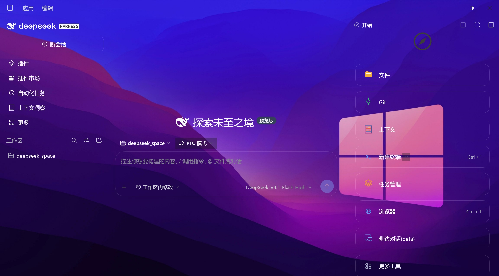
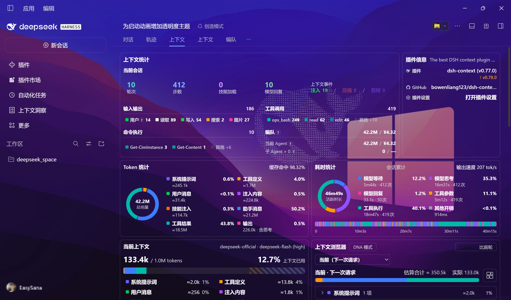
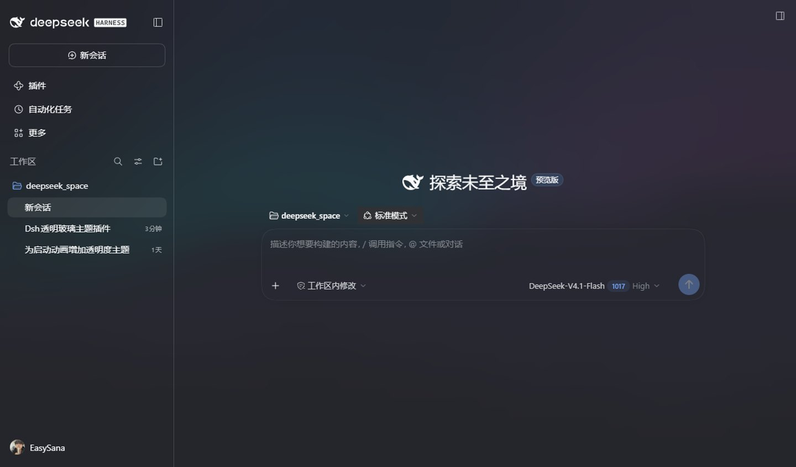
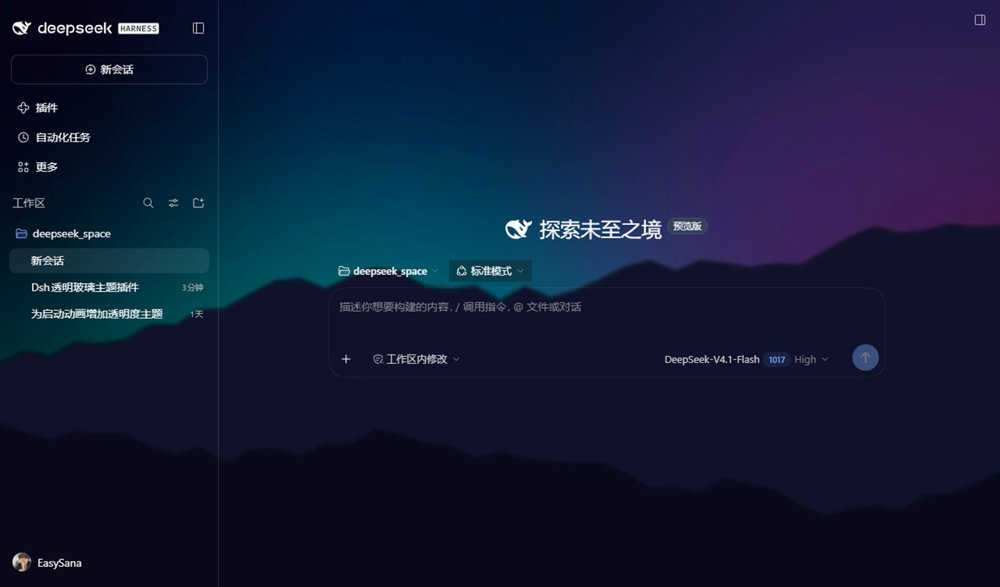
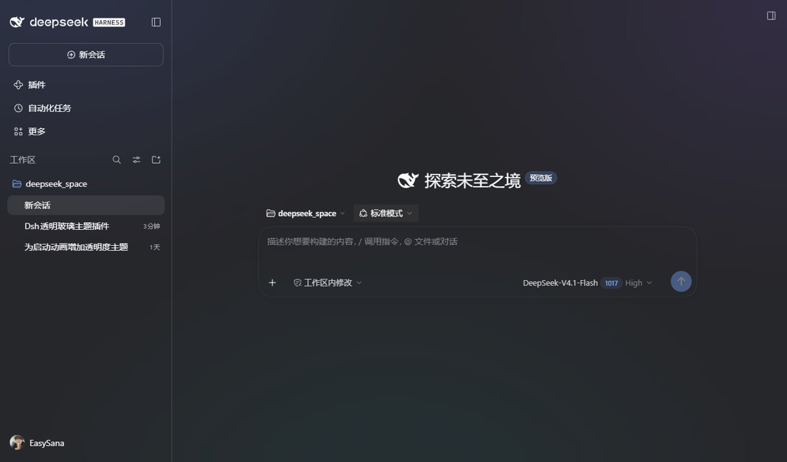
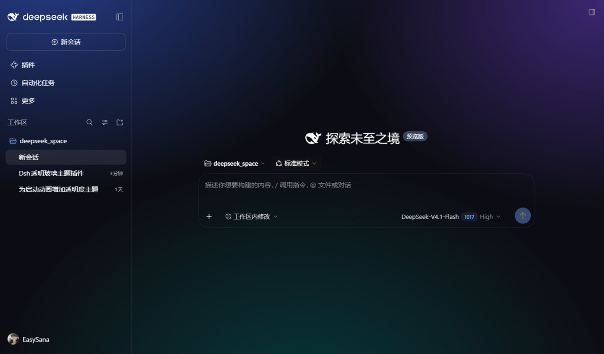

# DSH-Transparent-Frosted · 透明磨砂主题

<p>
  
  
  
  
</p>

把 DeepSeek Harness 变成一整块透明磨砂玻璃：一条滑杆在"真模糊的磨砂"与"背景彻底消失"之间连续过渡，整页所有区域、组件、展开面板作为**一张纸**一起变化；设置页有独立滑杆，互不干扰。

A transparent frosted-glass background for DeepSeek Harness. One slider moves the whole app between a genuinely blurred frost and a fully cleared background — every region, control and expanded page moves as **a single sheet**. The settings page keeps its own slider.

> 深色主题下效果最佳 —— 你的电脑桌面壁纸就是 DeepSeek Harness 的背景皮肤。
> **桌面端效果更好**：只有桌面端能把整个窗口背景让出去、直接透出你的桌面壁纸；Web 端只能露出插件自绘的背景。
>
> Best on a dark theme: your desktop wallpaper becomes the background skin. The **desktop app** is the better place to use it — only there can the window become truly transparent.

| 浓磨砂（0%） | 全透明（100%） |
|---|---|
|  |  |



## 安装

下载 [Releases](https://github.com/Yuanqs-pine/DSH-Transparent-Frosted/releases) 里的 `dsh-transparent-frosted-1.0.2.tgz`，放在任意目录，然后：

**桌面端**

```bash
dsh plugin --profile desktop add ./dsh-transparent-frosted-1.0.2.tgz
```

装完**刷新窗口**即可生效：按 `Ctrl+R`（macOS 为 `Cmd+R`）重新加载页面，插件会立刻套用默认配置（已开启、页面 72%、设置页 62%），不需要先打开设置页。

插件是前端代码，只能在页面加载时注入，所以"安装后完全不刷新就出现"是做不到的；但只要刷新窗口就行，不必退出整个进程。若刷新后界面没有变化，再完全退出并重新启动一次即可。

**Web 端**

```bash
dsh plugin --profile web add ./dsh-transparent-frosted-1.0.2.tgz
dsh --profile web web --port 8080
```

浏览器打开 `http://127.0.0.1:8080` 即可，同样刷新页面就会生效。

> Web 端没有"桌面壁纸"可以透出来：浏览器窗口背后是浏览器自己，插件只能自绘一层深色渐变当作背景底。所以 Web 端拉到全透明，透出的是这层渐变，而不是你的桌面 —— **想要"背景就是你的壁纸"的效果，请用桌面端。**

> 也可以直接指向克隆下来的源码目录：把上面的 `./dsh-transparent-frosted-1.0.2.tgz` 换成 `link:E:/path/to/DSH-Transparent-Frosted`。

## 使用

**设置 → 透明磨砂主题**

| 控件 | 说明 |
|---|---|
| 启动透明磨砂主题 | 总开关，关闭后立即恢复原生外观，粒子与滑杆一并失效 |
| 页面背景透明磨砂度 | 左＝浓磨砂，右＝全透明；整页作为一张纸一起变 |
| 设置页透明磨砂度 | 只影响设置页，与页面互不干扰 |
| 粒子效果 | 对话区中央的鲸鱼粒子，可单独关闭 |
| 恢复默认 | 回到 页面 72% / 设置页 62% |

粒子支持鼠标交互：悬停推开、按住拖动带走、松开后自然回落到鲸鱼轮廓。

## 两端效果对照

桌面端：窗口本身就是透明的，整页玻璃透出的是**你的桌面壁纸**。

| 桌面端 · 浓磨砂 0% | 桌面端 · 全透明 100% |
|---|---|
|  |  |

Web 端：窗口背后没有壁纸，插件自绘深色渐变作为底，看上去是彩色玻璃而不是"透出桌面"。

| Web 端 · 浓磨砂 0% | Web 端 · 全透明 100% |
|---|---|
|  |  |

**结论：桌面端效果更好**——只有桌面端的"全透明"是真的把应用背景让给了你的壁纸；Web 端在同样设置下只能露出插件自己画的那层渐变。

## 兼容

| 平台 | 状态 |
|---|---|
| Windows 桌面端 | ✅ |
| macOS 桌面端 | ✅ |
| Web（Chrome / Edge） | ✅ |
| 深色 / 浅色主题 | ✅ |

## 原理（三句话）

1. 页面底色与 `backdrop-filter` 只存在于 `body::before` 一处，整页只有一个上色层、一个模糊层，所以不会有区域各自磨砂。
2. 主题的九个表面色 token 被清成 `transparent`，卡片、输入框、按钮都不再自己涂色；设置页把 token 原值还原，因此保持独立。
3. 其它插件打开的整页面板由运行时几何探测识别并透明化，透出的仍是同一层页面底色。

自检（开发者）：`__dtgTheme.current()` / `__dtgTheme.set({ page: 0 })` / `__dtgTheme.rescan()`。

## 版本差异

| 版本 | 内容 |
|---|---|
| **v1.0.0** | 基线：单层页面磨砂 + 设置页独立滑杆、总开关、线稿图标、桌面端 / Web 双平台适配 |
| **v1.0.2** | 修复「跟随系统」：系统外观是深色时，从浅色切到跟随系统后设置页与页面底色仍停在浅色配色（现在监听 dsh 的 `data-ds-theme-source` 与 `data-ds-dark-theme`，重新取色并刷新） |
| **v1.0.1** | 鲸鱼粒子（可关闭，带悬停推开 / 拖拽带走的指针物理）；开关改为单胶囊样式、行距对齐设置页；关闭总开关时自动卸载粒子图层 |

回退基线：`git checkout v1.0.0`

## 卸载

```bash
dsh plugin --profile desktop remove dsh-transparent-frosted
```

## 文件

```
client.js        前端主体（样式注入 / 引擎 / 设置面板 / 粒子）
index.js         宿主侧空实现
cordis.patch.yml 声明式挂载
locale/          中英文名称与描述
icon.svg         线稿图标
docs/            截图
```

## License

MIT
